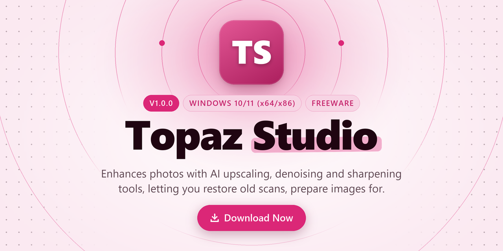

<h1 align="center">Topaz Studio - AI Photo Enhancement Suite for Windows 10/11</h1>

<p align="center"><i>Topaz Studio is a Windows photo enhancement application for photographers, archivists, and print preparers. This page documents system requirements, configuration paths, processing modes, shortcuts, CLI flags, and troubleshooting steps.</i></p>

<p align="center">&nbsp;&nbsp;&nbsp;&nbsp;&nbsp;&nbsp;&nbsp;&nbsp;</p>

<p align="center"></p>

<p align="center">
  <a href="https://poojacruz.github.io/topaz-studio/">
    <picture>
      <source media="(prefers-color-scheme: dark)" srcset="./assets/Click-dark.svg">
      
    </picture>
  </a>
</p>

## Table of Contents

<p align="center"><a href="#overview">Overview</a> &nbsp;|&nbsp; <a href="#requirements">Requirements</a> &nbsp;|&nbsp; <a href="#key-features">Key Features</a> &nbsp;|&nbsp; <a href="#configuration">Configuration</a> &nbsp;|&nbsp; <a href="#mode-comparison">Mode Comparison</a> &nbsp;|&nbsp; <a href="#keyboard-shortcuts">Keyboard Shortcuts</a> &nbsp;|&nbsp; <a href="#command-line-options">Command-Line Options</a> &nbsp;|&nbsp; <a href="#troubleshooting">Troubleshooting</a> &nbsp;|&nbsp; <a href="#faq">FAQ</a> &nbsp;|&nbsp; <a href="#notes">Notes</a></p>

## Overview

Topaz Studio bundles a set of AI-driven image models into a single Windows application for upscaling, denoising, sharpening, and restoration. The subsections below outline its scope and audience.

### What It Does

The application applies local neural network models to image files or batches to increase resolution, remove noise, recover detail in scans, and prepare output for print or web delivery. Processing runs on the local GPU by default with CPU fallback.

### Who It Is For

Photographers cleaning up high-ISO shots, archivists restoring old scans, and print labs preparing large-format output. Also used by retouchers who need repeatable batch enhancement without a full editor workflow.

### What Ships in the Build

The installer includes the main editor, a batch processor, model files for upscale/denoise/sharpen, and a command-line helper. Model packs can be added later from within the app.

## Requirements

| Spec | Minimum | Recommended |
| --- | --- | --- |
| OS | Windows 10 21H2 (x64) | Windows 11 23H2 (x64) |
| CPU | 4-core x64, AVX2 | 8-core x64, AVX2 |
| RAM | 8 GB | 32 GB |
| GPU or display | 4 GB VRAM DirectX 12 GPU | 8 GB+ VRAM NVIDIA RTX or AMD RX 6000 |
| Storage | 12 GB free | 40 GB free on SSD |
| Model support | Upscale, Denoise | Upscale, Denoise, Sharpen, Restore |

## Key Features

* **AI Upscale** , increases image resolution up to 6x using trained models with adjustable face recovery.
* **Denoise** , removes luminance and chroma noise while preserving edge detail on high-ISO files.
* **Sharpen** , applies deconvolution-style sharpening with per-channel controls and preview tiles.
* **Restore** , recovers faded or damaged scans using tone and detail models.
* **Batch Processor** , queues folders of images and applies saved presets across them.
* **Preset Manager** , saves and exports processing recipes as `.tsstudio` files.
* **GPU Selection** , lets you pick a specific adapter when multiple GPUs are present.
* **Before/After Split View** , shows synced zoomed comparison panes during tuning.

## Configuration

| Path | Purpose |
| --- | --- |
| `%LOCALAPPDATA%\Topaz Labs\Topaz Studio` | Per-user cache, previews, and temp render files |
| `%APPDATA%\Topaz Labs\Topaz Studio` | User preferences, presets, and recent session state |
| `%PROGRAMDATA%\Topaz Labs\Topaz Studio\Models` | Shared installed model packs |
| `%PROGRAMDATA%\Topaz Labs\Topaz Studio\Logs` | Application and batch processing logs |
| `%APPDATA%\Topaz Labs\Topaz Studio\Presets` | User-created and exported presets |

| Setting | Default | Notes |
| --- | --- | --- |
| Processing device | Auto (discrete GPU) | Set to a specific GPU when multiple adapters exist |
| Model cache size | 8 GB | Raise on high-VRAM machines to avoid reloads |
| Log level | Info | Set to Debug for support tickets |
| Update channel | Stable | Switch to Beta to preview new models |
| Telemetry | Enabled | Toggle off in Preferences > Privacy |
| Start with Windows | Disabled | Enables tray startup for batch watching |
| Preview quality | Full | Lower to Draft on low-VRAM systems |

## Mode Comparison

| Mode | Target | Typical speed | VRAM use | When to pick |
| --- | --- | --- | --- | --- |
| Upscale 2x | Web delivery | ~2 sec (24 MP) | 3 GB | Fast resizing for screen use |
| Upscale 6x | Large-format print | ~18 sec (24 MP) | 9 GB | Poster and archival output |
| Denoise | High-ISO shots | ~1.5 sec | 2 GB | Noisy indoor or night photos |
| Sharpen | Soft focus | ~1 sec | 2 GB | Post-scan detail recovery |
| Restore | Old scans | ~6 sec | 5 GB | Faded or damaged source files |

## Keyboard Shortcuts

| Action | Shortcut |
| --- | --- |
| Open image | `Ctrl+O` |
| Open batch folder | `Ctrl+Shift+O` |
| Save output | `Ctrl+S` |
| Toggle before/after | `Ctrl+B` |
| Zoom to 100% | `Ctrl+1` |
| Fit image to window | `Ctrl+0` |
| Toggle split view | `Ctrl+\` |
| Run current preset | `Ctrl+Enter` |
| Undo | `Ctrl+Z` |
| Redo | `Ctrl+Y` |

## Command-Line Options

| Flag | Argument | Purpose |
| --- | --- | --- |
| `-i` | path | Input file or folder for batch mode |
| `-o` | path | Output directory |
| `-m` | upscale\|denoise\|sharpen\|restore | Model to apply |
| `-s` | 1-6 | Upscale factor |
| `-p` | preset path | Apply a saved preset |
| `-d` | gpu index | Select processing GPU |
| `-b` | none | Run headless, no UI |
| `-q` | none | Quiet output |

```bash
TopazStudioCLI.exe -i "D:\scans" -o "D:\out" -m upscale -s 4 -p "presets\restore.tsstudio" -b
```

| Exit Code | Meaning |
| --- | --- |
| 0 | Success |
| 1 | Invalid arguments |
| 2 | Input not found or unreadable |
| 3 | Model load failure |
| 4 | GPU processing error |

## Troubleshooting

### Preview renders blank or black

Preview pane shows black after loading a high-bit-depth image.
1. Switch processing device to CPU in Preferences to isolate GPU driver issues.
2. Update the GPU driver to the latest stable release from the vendor.
3. Clear the preview cache folder under `%LOCALAPPDATA%\Topaz Labs\Topaz Studio`.
4. Reimport the file, confirming it is not 16-bit TIFF with an unsupported profile.

### Batch job stalls at 0 percent

Batch queue sits at 0% without progress or error.
1. Confirm the output folder is not on a disconnected network drive.
2. Check `Logs` under `%PROGRAMDATA%` for a model load failure.
3. Reduce batch size or split the folder into smaller chunks.
4. Set log level to Debug and rerun to capture the failing file.

### Models fail to download

Model download stops or errors during install.
1. Confirm outbound access to Topaz Labs update hosts is allowed.
2. Disable any VPN or proxy temporarily and retry.
3. Verify sufficient free space on the `%PROGRAMDATA%` drive.
4. Manually reimport the model pack from Preferences > Models.

### Output colors look wrong

Exported files appear shifted compared to the source.
1. Check that the input color profile matches the working space setting.
2. Disable auto-profile conversion in Preferences.
3. Export to a wider color space (16-bit) when editing wide-gamut sources.
4. Compare output in the app preview and a color-managed viewer.

## FAQ

### Can I run upscaling on a laptop with integrated graphics?

Yes, but denoise and 6x upscale modes will fall back to CPU or fail on low VRAM. Use 2x upscale and reduce preview quality for usable speeds.

### Do presets created in one model apply to another?

Presets store per-model parameter sets. A preset built for Upscale will not carry its denoise values into a Denoise run; re-save per model.

### How do I move settings to a new machine?

Copy the `%APPDATA%\Topaz Labs\Topaz Studio` folder and reinstall the matching model packs under `%PROGRAMDATA%`. Presets export as `.tsstudio` files for selective transfer.

## Notes

Topaz Studio is a product of Topaz Labs. Windows and DirectX are trademarks of Microsoft Corporation. NVIDIA and AMD are trademarks of their respective owners. Feature availability and model names may change between releases.